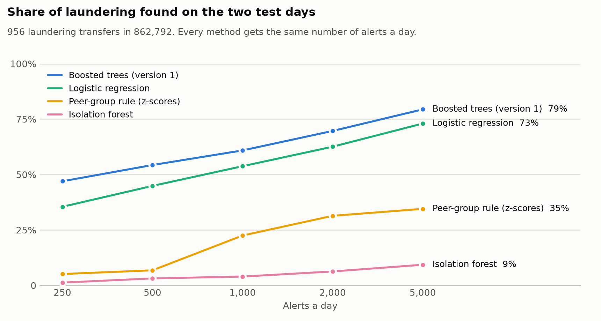
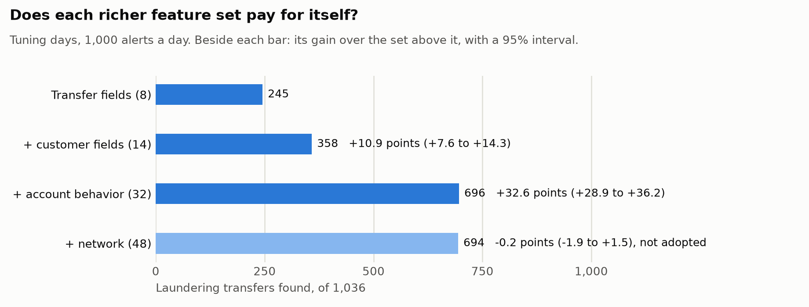
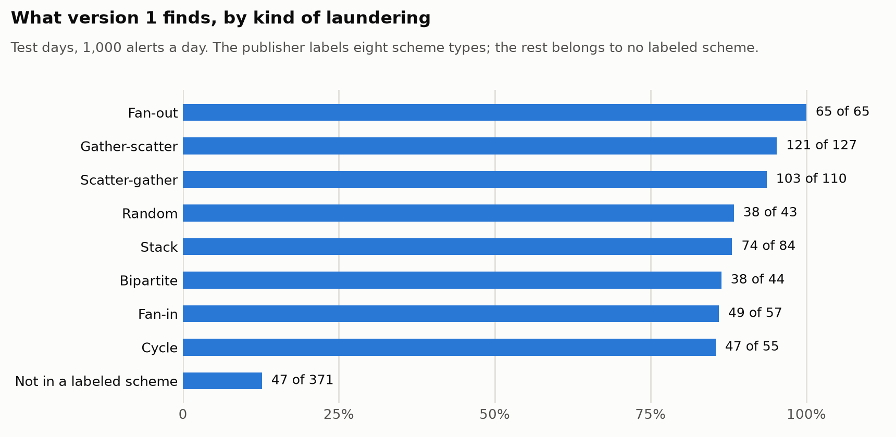
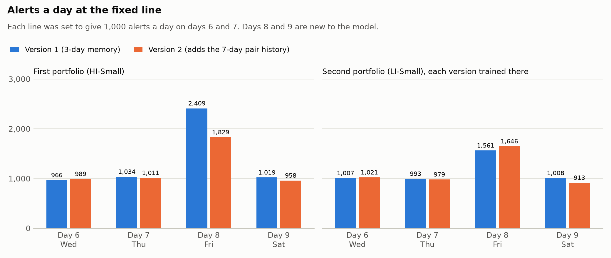
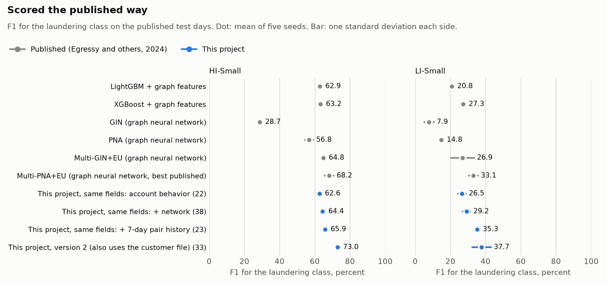

# Transaction Monitoring Model on a Public AML Benchmark

A portfolio project on public, synthetic data. It scores bank transfers for money laundering. It picks the model by test, sets an alert line, watches the model on new days, finds a fault, fixes it, and checks the fix on a second portfolio.

Built in November 2026 with Claude as the coding assistant. No employer's data, code or results are in it. Nothing is deployed.

Run on my own machine on November 23, 2026 (Windows, Python 3.13, the pinned versions). "The result in six lines" and "My run" give my numbers. The step sections further down quote the reference run this project shipped with, and `results/` holds every report from my run.

## What this is

| | |
|---|---|
| The job | Each night, rank the day's transfers so that reviewers open the most suspicious ones first |
| Data | IBM's anti-money-laundering benchmark. HI-Small: 5,078,345 transfers, 5,177 labeled laundering (1 in 981). A second portfolio, LI-Small: 6,924,049 transfers, 1 in 1,942 |
| Synthetic | Every transfer comes from a simulator. No real customer or bank is in the data. Every laundering transfer is labeled |
| Methods compared | A peer-group z-score rule, an isolation forest, a logistic regression, gradient-boosted trees |
| The model | Gradient-boosted trees (XGBoost). Version 1 has 32 features. Version 2 has 33 |
| The split | By day. Days 2 to 5 to learn, days 6 and 7 to tune, days 8 and 9 to test |
| Not in it | No real data. No neural network. No scoring at the moment of payment. No live labels. Nothing deployed |

Two words used throughout. **Share found** is the share of all laundering transfers that got an alert (recall). **Precision** is the share of alerts that were laundering.

## The result in six lines

1. On two unseen days, at 1,000 alerts a day, version 1 found 582 of 956 laundering transfers (60.9%). A logistic regression found 514, a tuned peer-group z-score rule 215, an isolation forest 38.
2. 16 network features were built, tested and left out. On the tuning days they changed the share found by -0.2 points, with a 95% interval from -1.9 to +1.5.
3. Almost everything the model finds belongs to a labeled laundering scheme: 535 of 585. Outside the schemes it finds 47 of 371.
4. A fixed alert line set for 1,000 alerts a day raised 2,409 on the first unseen Friday. 64% of those alerts were pairs of accounts that had paid each other exactly 7 days earlier.
5. Version 2 adds the pair's history over the 7 days before. Across five training seeds it found more laundering than version 1 on every draw: +2.4 points on average on the first portfolio and +2.3 on a second portfolio with other banks and customers. It lowered the Friday's alerts on all five draws on the first portfolio, and clearly on two of five on the second. A single run can show a much larger or smaller fix than that.
6. Scored the way the published papers score, with the same input fields, the trees reach an F1 of 62.6 to 65.9 on HI-Small and 26.5 to 35.3 on LI-Small, depending on the feature set. The best published tree baseline reports 63.2 and 27.3, and the best published graph neural network 68.2 and 33.1. Those models were not rerun here.



## My run, November 23, 2026

I ran every step on Windows with Python 3.13 and the pinned library versions. The data files and all 51 features matched the reference run byte for byte. The peer-group rule and the isolation forest matched exactly. The boosted trees and the logistic regression did not: XGBoost's Windows build and my processor's arithmetic give slightly different trees from the same data and seed. Every choice came out the same. `check_my_run.py` reports 163 of 258 numbers the same.

| Number | Reference run | My run |
|---|---|---|
| Version 1, test days, of 956 | 578 | 582 |
| Logistic regression | 502 | 514 |
| Peer-group rule; isolation forest | 215; 38 | 215; 38 |
| Network features' gain, tuning days | +1.3 points (-0.4 to +2.9) | -0.2 points (-1.9 to +1.5) |
| The alert line | 0.0779, about 1 in 14 | 0.0768, about 1 in 15 |
| Friday alerts at the line, version 1 | 3,332 | 2,409 |
| Friday alerts from weekly pairs | 74% | 64% |
| Friday alerts, version 2 | 1,148 | 1,829 |
| Version 2, test days, of 956 | 607 | 589 |
| Second portfolio, found of 668, version 1 to 2 | 233 to 283 | 249 to 252 |
| Second portfolio, Friday alerts, version 1 to 2 | 1,683 to 1,075 | 1,561 to 1,646 |
| Missed below the line; error of the banded plan at 3,000 reviews | 348; ±58% | 346; ±62% |
| F1, same fields, HI-Small | 62.8 to 65.6 | 62.6 to 65.9 |
| F1, same fields, LI-Small | 28.6 to 35.7 | 26.5 to 35.3 |

The one result that did not carry over is the size of version 2's fix. The next section is what I did about it. My choices and the reasons for them are in [DECISIONS.md](DECISIONS.md).

## My extension, November 23, 2026: is the fix steady across training seeds?

My rerun did not reproduce the fix on the second portfolio (249 to 252, where the reference shows 233 to 283). One run cannot say which is right, because each tree samples 80% of the rows and 70% of the columns, and the seed picks the sample. So I retrained version 1 and version 2 with five seeds on both portfolios, the same way step 5 trains them.

    python extensions/seed_check.py .

About 20 minutes. It changes nothing in the project. Laundering found on days 8 and 9 at 1,000 alerts a day, and alerts on the Friday at each version's own line:

| Portfolio | Seed | Version 1 | Version 2 | Gain | Friday alerts, version 1 | Friday alerts, version 2 |
|---|---|---|---|---|---|---|
| First (HI-Small), of 956 | Project's seed | 582 | 589 | +7 | 2,409 | 1,829 |
| | 1 | 578 | 599 | +21 | 2,183 | 1,295 |
| | 2 | 577 | 594 | +17 | 1,722 | 1,486 |
| | 3 | 576 | 612 | +36 | 2,118 | 1,026 |
| | 4 | 561 | 597 | +36 | 3,375 | 1,488 |
| | **Mean** | **574.8** | **598.2** | **+23.4 (+2.4 points)** | **2,361** | **1,425** |
| Second (LI-Small), of 668 | Project's seed | 249 | 252 | +3 | 1,561 | 1,646 |
| | 1 | 235 | 238 | +3 | 2,180 | 2,013 |
| | 2 | 242 | 256 | +14 | 1,586 | 1,573 |
| | 3 | 242 | 264 | +22 | 1,707 | 1,184 |
| | 4 | 233 | 268 | +35 | 1,358 | 1,256 |
| | **Mean** | **240.2** | **255.6** | **+15.4 (+2.3 points)** | **1,678** | **1,534** |

- Version 2 found at least as much laundering as version 1 on all ten draws. Mean gain: +2.4 points on the first portfolio, +2.3 on the second.
- Friday alerts fell on all five draws on the first portfolio (2,361 to 1,425 on average). On the second they fell clearly on two draws, were about even on two, and rose on one.
- Version 1's Friday spike itself runs from 1,722 to 3,375 alerts across seeds.
- The reference run's interval for the fix (+4.6 to +10.4 points) resamples the test days but holds the trained models fixed. It leaves the training draw out, so it is too narrow.

Limits. Five seeds is few. I did not write down what I expected before running it. The seeds and the second portfolio had been seen, so this checks steadiness and is not a blind test.

## How it works

Seven scripts, run in order.

| Step | Script | What it does | Time on 2 cores |
|---|---|---|---|
| 1 | `01_get_data.py` | Downloads the six data files and checks each against its fingerprint | Depends on your connection (about 650 MB) |
| 2 | `02_features.py` | Builds 51 features per transfer for both portfolios, using only what was known at the end of that transfer's day | 2 minutes |
| 3 | `03_models.py` | Scores the same days with the rule, the forest, the regression and four boosted models. Decides which feature set to keep | 8 minutes |
| 4 | `04_alert_line.py` | Calibrates the scores, sets the alert line, tests how to estimate what the line misses, compares champion and challenger | 10 seconds |
| 5 | `05_monitor.py` | Watches version 1 day by day, explains the Friday, builds version 2, checks it on the second portfolio | 4 minutes |
| 6 | `06_published_protocol.py` | Scores the model under the published rules, five seeds, both portfolios | 36 minutes |
| 7 | `07_report.py` | Writes the reasons behind each alert, five charts, the model document and the headline numbers | Under 1 minute |

Steps 3 to 7 each write a report in `results/` that reads on its own: `models.md`, `alert_line.md`, `monitoring.md`, `published_protocol.md`, and from step 7 `reasons.md` and `model_document.md`.

## The data

The IBM benchmark comes from a simulator of banks, companies and people that pay each other. Some of them launder money in eight scripted patterns (fan-in, fan-out, cycle, stack and others), and the publisher's pattern file says which transfers belong to which scheme. A second kind of laundering transfer is labeled but belongs to no listed scheme.

| Day | Weekday | Transfers | Laundering | Used for |
|---|---|---|---|---|
| 0 | Thursday | 1,114,921 | 322 | History only |
| 1 | Friday | 754,449 | 408 | History only |
| 2 | Saturday | 207,382 | 391 | Training |
| 3 | Sunday | 207,430 | 407 | Training |
| 4 | Monday | 482,650 | 471 | Training |
| 5 | Tuesday | 482,089 | 531 | Training, and it sets the number of trees |
| 6 | Wednesday | 482,751 | 497 | Tuning |
| 7 | Thursday | 482,773 | 539 | Tuning |
| 8 | Friday | 654,467 | 514 | Test |
| 9 | Saturday | 208,325 | 442 | Test |
| 10 to 17 | | 1,108 | 655 | Left out |

Three things about these days shape the whole project.

- **Days 0 and 1 are history only.** Most features look back 3 days, so the first two days have less behind them than the rest. A model that also learned from them did worse on the tuning days (674 found against 685), so no model learns from their rows.
- **After day 9 the file is not a bank day.** It holds 1,108 transfers over eight days, most of them the last legs of laundering schemes. Those days are scored and left out of every result. The published papers keep them in their test set, which is one reason their F1 cannot be compared with a regular day (see step 6).
- **Ten days hold one weekly cycle.** The only Friday before the test days is day 1, a history-only day. That is what step 5 runs into.

The data is released under the Community Data License Agreement, Sharing, version 1.0. `data/manifest.json` lists the source, the license and the SHA-256 fingerprint of each file.

## The features

One row per transfer. Every feature of a transfer uses only transfers up to the end of that transfer's day. The monitoring is a nightly batch: it scores a day after the day has closed.

| Group | Features | What they describe | Examples |
|---|---|---|---|
| Transfer | 8 | The transfer itself | Amount, amount against others in the same currency and payment format, payment format, time of day |
| Customer | 6 | Who owns the two accounts | Customer type of sender and receiver, same owner, banks in different countries |
| Behavior | 18 | How busy each account has been, today and over 3 days | Transfers the sender made today, ACH transfers the receiver got in 3 days, transfers between this pair on the 2 days before |
| Network | 16 | Who pays whom | Different accounts the sender paid, money coming back, closed loops of ACH transfers, one source reaching one end through several middle accounts |
| Added later | 3 | A longer memory | Transfers between this pair on the 7 days before (used by version 2), and the sender's and receiver's 7-day totals (tried and left out) |

Loops are found as strongly connected groups of the 3-day and 5-day ACH graphs. Split-and-merge paths are counted with sparse matrices. `features.py` holds all of it in about 290 lines.

Two tests guard the features (`tests/test_features.py`, a few seconds, no data file needed):

- **No look-ahead.** The features of every transfer up to day d come out the same whether or not the later days exist.
- **A slow second opinion.** All 51 features of 7,764 made-up transfers are recomputed with plain loops and sets, straight from their definitions, and must equal the fast version.

And one test guards the tests. `tests/plant_faults.py` breaks the feature code four ways, one at a time (a window that peeks a day ahead, a history that includes today, transfers to self counted as activity, a loop that needs only a one-way connection), and runs the feature tests on each broken copy. All four are caught.

## Step 3: which method, and which features

All methods are compared the same way: each gets the same number of alerts a day, the top of its own ranking, on the two test days.

| Method | Found, of 956 | Share found | 95% interval | Precision |
|---|---|---|---|---|
| Peer-group rule (z-scores) | 215 | 22.5% | 17.7% to 27.4% | 10.8% |
| Isolation forest (sees no labels) | 38 | 4.0% | 2.6% to 5.5% | 1.9% |
| Logistic regression, all 48 features | 502 | 52.5% | 47.7% to 57.1% | 25.1% |
| Boosted trees, transfer fields (8) | 245 | 25.6% | 21.8% to 29.1% | 12.2% |
| Boosted trees, + customer fields (14) | 346 | 36.2% | 32.1% to 40.0% | 17.3% |
| **Boosted trees, + account behavior (32): version 1** | **578** | **60.5%** | **55.5% to 64.9%** | **28.9%** |
| Boosted trees, + network (48) | 580 | 60.7% | 55.6% to 65.1% | 29.0% |

Test days, 1,000 alerts a day, so 2,000 alerts in all. `results/models.md` has the same table at 250, 500, 2,000 and 5,000 alerts a day.

**The peer-group rule got a fair run.** It is the method of my earlier payments project: compare a quantity with its peer group and flag what stands far out. Four variants were built, with peer means and spreads taken from the training days:

| Variant | Found on the tuning days, of 1,036 |
|---|---|
| Classic: the largest z-score of amount, sender volume and receiver volume | 2 |
| The largest z-score of all 34 quantities | 101 |
| The best single z-score, high or low side | 144 |
| The sum of the best five z-scores, chosen on the training days | 263 |

The last one was kept as "the rule". Large amounts and busy accounts are not where the laundering is in this data: the classic rule finds 2.

**The intervals resample whole schemes.** Transfers of one laundering scheme are found or missed together, so treating each transfer as independent would make every interval too narrow. The 95% interval for share found redraws whole schemes 2,000 times. Precision uses a Wilson interval.

**A richer feature set has to pay for itself.** The decision follows a rule, not a look at the table: adopt a set only if, on the tuning days at 1,000 alerts a day, the whole 95% interval for its gain is above zero.

| From | To | Found before | Found after | Gain in share found | 95% interval | Adopted |
|---|---|---|---|---|---|---|
| Transfer fields | + customer fields | 241 | 354 | +10.9 points | +8.0 to +13.9 | Yes |
| + customer fields | + account behavior | 354 | 685 | +31.9 points | +28.3 to +35.5 | Yes |
| + account behavior | + network | 685 | 698 | +1.3 points | -0.4 to +2.9 | No |



So version 1 is the 32-feature model. The network features are kept in the code and in the tests, and stay out of the model. On the test days the two models are 2 transfers apart (578 and 580).

Other choices made on the tuning days, all in `results/models.md`:

- **Depth and leaf size** from a grid of four. The best and worst differ by 0.009 in average precision. Depth 8, smallest leaf weight 5.
- **The number of trees** by early stopping on day 5: 139.
- **No class weight.** Weighting laundering up by the full imbalance (765 to 1) found 647 where no weight found 685, and pushed the mean score to 15 times the true rate.
- **Boosting against the regression:** 685 against 596 on the tuning days, +8.6 points (interval +6.0 to +11.1).

**What the model finds and what it does not.**



It finds 91% of the laundering that belongs to a labeled scheme (534 of 585) and 12% of the rest (44 of 371). The 371 are laundering transfers that sit in no listed pattern. Nothing in these features separates most of them from an ordinary payment.

## Step 4: the alert line, and what it misses

**Calibration.** A score is useful as a probability only if "10%" means one in ten. Raw scores, Platt scaling and isotonic regression were each fitted on one tuning day and checked on the other, both ways. Isotonic regression had the lowest log loss and was kept.

**The line.** The score that gives 1,000 alerts a day on the tuning days is 0.0779. A transfer exactly at the line has about a 1 in 14 chance of being laundering. On the tuning days the line gave 963 and 1,037 alerts at 34% precision.

**The same line on the test days.**

| Day | Weekday | Alerts at the line | Laundering the probabilities expect in them | Found | Precision | Top 1,000 of the day: found |
|---|---|---|---|---|---|---|
| 6 | Wednesday | 963 | 333 | 331 | 34.4% | 333 |
| 7 | Thursday | 1,037 | 355 | 356 | 34.3% | 352 |
| 8 | Friday | 3,332 | 579 | 304 | 9.1% | 274 |
| 9 | Saturday | 994 | 300 | 304 | 30.6% | 304 |

Day 9 behaves. Day 8 does not: three times the alerts, and the probabilities expect 579 laundering transfers among them where 304 are found. Step 5 picks that up.

**What does the line miss?** In production nobody reviews below the line, so the misses have to be estimated from a sample. Here the truth is known: 348 of the 858,466 transfers below the line are laundering, 1 in 2,467. That makes it possible to test sampling plans before trusting one. Each plan spends 3,000 reviews and is drawn 5,000 times.

| Plan | Laundering in the sample, on average | Samples that find none | Typical error of the estimate | 95% interval covers the truth |
|---|---|---|---|---|
| Simple random sample below the line | 1.2 | 29% | ±90% | 96.7% |
| By score band, in proportion to band size | 1.2 | 30% | ±92% | 87.3% |
| By score band, planned on the tuning days | 5.6 | 0% | ±58% | 90.6% |

The planned design puts 425 reviews in the band just below the line, 1,029 in the middle band and 1,546 far below, sized from where the tuning days showed the misses to be. It cuts the error by a third. Its interval is still too narrow at this size (it covers the truth 90.6% of the time, where 95% is the claim), and comes right at 10,000 reviews (94.1%, error ±31%). Rare events are expensive to count: that is the finding.

**Champion and challenger**, same alerts a day on the test days:

| Comparison | First finds | Second finds | Gain | 95% interval |
|---|---|---|---|---|
| Peer-group rule against version 1 | 215 | 578 | +38.0 points | +32.4 to +43.5 |
| Logistic regression against version 1 | 502 | 578 | +7.9 points | +5.0 to +10.9 |
| Version 1 against the network model | 578 | 580 | +0.2 points | -1.3 to +1.8 |

A live split test of the regression against version 1 would need 1,725 alerts per arm to tell 29.8% precision from 34.2% with 80% power at the 5% level, about 4 days at half the budget each.

## Step 5: monitoring, a fault, a fix

Five checks, written down in `monitoring_rules.json` before step 5 was first run. They were not written blind: step 4 had already shown the Friday's alert count, and its cause had been looked into. The limits are the usual round numbers (half or double the alert volume, a PSI of 0.1 and 0.25) and have not changed since step 5 first ran. The first four checks can run the same night. The fifth needs the reviewers' labels.

| Check | Watches | Trips when |
|---|---|---|
| Feed | Transfers received in the day | Under 0.3 or over 3 times the median training day |
| Alert volume | Alerts at the fixed line | Under half or over double the tuning days |
| Score shift | Population stability index (PSI) of the score | Over 0.1 amber, over 0.25 red |
| Feature shift | The largest PSI among the model's features | Over 0.1 amber, over 0.25 red |
| Precision | Precision of the day's alerts | Under the low end of the tuning days' 95% interval (32.3%) |

**Version 1, day by day.**

| Day | Transfers | Feed | Alerts | Alert volume | Score shift | Feature shift | Precision |
|---|---|---|---|---|---|---|---|
| 8, Friday | 654,467 | ok | 3,332 | AMBER | 0.126, AMBER | 0.421, RED | 9.1%, AMBER |
| 9, Saturday | 208,325 | ok | 994 | ok | 0.054, ok | 0.558, RED | 30.6%, AMBER |
| 10 | 396 | RED | not read | | | | |

Three readings.

- **The feed check does its job.** From day 10 the file holds 396 transfers a day or fewer. The check stops scoring. Without it the line would have raised 627 alerts on those days, 596 of them right, and precision would have looked better than ever on a feed that had stopped.
- **The feature-shift check cannot tell a weekday from a fault.** It is red on Friday and on Saturday, against a reference of a Wednesday and a Thursday. Saturday's alerts were normal: 994 of them, at 30.6% precision. A two-day reference does not cover the week.
- **Alert volume is the check that caught the Friday.**

**What the Friday alerts have in common.** This needs no labels.

| Day | Alerts | Pair had no transfer on the 2 days before | Pair had a transfer exactly 7 days before | Sender sent nothing in the 3 days before |
|---|---|---|---|---|
| 7, Thursday | 1,037 | 96% | 4% | 60% |
| 8, Friday | 3,332 | 99% | 74% | 87% |
| 9, Saturday | 994 | 98% | 4% | 56% |

Version 1 remembers 3 days. An account that pays the same account once a week looks, each Friday, like a first-time pair. Once labels are in: 3,028 of the 3,332 alerts were false, and 81% of those false alerts were weekly pairs.

**Version 2** adds one feature: the number of transfers between this pair on the 7 days before. Same training days, same settings.



| | Version 1 | Version 2 |
|---|---|---|
| First portfolio, alerts on day 8 | 3,332 | 1,148 |
| First portfolio, found at 1,000 a day on days 8 and 9, of 956 | 578 | 607 |
| **Second portfolio, alerts on day 8** | **1,683** | **1,075** |
| **Second portfolio, found at 1,000 a day on days 8 and 9, of 668** | **233** | **283** |

Three things to be straight about.

- **The tuning days could not justify this feature.** On Wednesday and Thursday version 2 finds 694 where version 1 finds 685 (+0.9 points, interval -0.8 to +2.7). By the rule of step 3 it would not be adopted. Its case is the Friday, and the tuning days hold no Friday.
- **The first portfolio's test days are not a clean test of it.** They are the days that suggested the change. The feature was chosen from the table above, before any model with it was fitted. The better test is the second portfolio, whose days played no part in finding the problem or in designing the feature. There both versions are trained the same way on that portfolio's own days 2 to 5, and the gain is +7.5 points (interval +4.6 to +10.4).
- **The second portfolio was not a blind test either.** Two candidates were fitted in one trial on both portfolios: the pair's 7-day history, which came straight from the table above, and a wider one that also adds the sender's and the receiver's 7-day totals. So the second portfolio's test days had been seen for both before version 2 was fixed. The wider one failed there: it found 232 of 668, against 233 for version 1, and raised 2,268 alerts on its Friday. On the tuning days it showed no clear gain on either portfolio (697 against 694, and 309 against 304), and by the rule of step 3 that is what drops it.

Version 2's new feature is left out of the feature-shift check, because on the reference days its 7 days of history are still filling up. After the fix the precision check is still amber on both test days (26.7% and 31.3% against a floor of 32.6%). New days run a few points under the days the line was tuned on. By the written rules that calls for revalidation, and the rules are left as written.

**Does a model carry over to a new portfolio?** Version 2 as trained on the first portfolio was applied to the second, which has other banks and customers and half the laundering rate.

- The nightly checks see nothing on days 6 and 7. Feature by feature the two portfolios look alike (largest PSI 0.057).
- The precision check sees it at once: 14% to 17% against a floor of 32.6%.
- At 1,000 alerts a day the carried-over model finds 263 and a model trained on the second portfolio finds 283 (+3.0 points, interval -0.3 to +6.5).

**Does retraining help?** With the labels of days 6 and 7 added to the training data, version 2 finds 609 against 607 on days 8 and 9 (+0.2 points, interval -1.5 to +1.9). Two more days of labels did not move it.

## Step 6: scored the way the published papers score

Everything above uses this project's own test: two regular days and a fixed number of alerts a day. Published work on this benchmark scores another way, so this step applies the published rules to the same models. The rules were read from the paper and from its code.

| | Published | This step |
|---|---|---|
| Split | Whole days, as close to 60/20/20 as whole days allow: days 0 to 5, days 6 and 7, day 8 onward | The same |
| Days after day 9 | In the test part | In the test part here. Left out everywhere else in this project |
| Measure | F1 for the laundering class, mean of five seeds | The same |
| Fields the model sees | Sender, receiver, time, amount received, currency received, payment format | "Same fields": those six. Version 2 also reads the customer file, the bank and the currency paid |
| What a test transfer may use | The whole graph, later transfers included | Only transfers up to the end of its own day |
| Chosen on the validation days | Settings, loss weights, the training round to keep | The number of trees and the alert line |
| Training rows | Days 0 to 5 | Days 2 to 5. Days 0 and 1 are history only |

F1 in percent, mean ± spread over five seeds.

| Model | Source | HI-Small | LI-Small |
|---|---|---|---|
| LightGBM + graph features | Published | 62.86 ± 0.25 | 20.83 ± 1.50 |
| XGBoost + graph features | Published | 63.23 ± 0.17 | 27.30 ± 0.33 |
| GIN (graph neural network) | Published | 28.70 ± 1.13 | 7.90 ± 2.78 |
| PNA (graph neural network) | Published | 56.77 ± 2.41 | 14.85 ± 1.46 |
| Multi-GIN+EU (graph neural network) | Published | 64.79 ± 1.22 | 26.88 ± 6.63 |
| Multi-PNA+EU (graph neural network, best published) | Published | 68.16 ± 2.65 | 33.07 ± 2.63 |
| Boosted trees, same fields: account behavior (22 features) | This run | 62.83 ± 1.26 | 29.18 ± 0.93 |
| Boosted trees, same fields: + network (38 features) | This run | 65.16 ± 0.53 | 28.65 ± 1.82 |
| Boosted trees, same fields: + 7-day pair history (23 features) | This run | 65.58 ± 1.52 | 35.70 ± 1.16 |
| Boosted trees, version 2 (33 features, reads more fields) | This run | 73.14 ± 0.59 | 39.27 ± 0.80 |



How to read it.

- **Same fields, same rules.** The trees score 62.8 to 65.6 on HI-Small and 28.6 to 35.7 on LI-Small, depending on the feature set. The best published tree baseline reports 63.2 and 27.3. The best published graph neural network reports 68.2 and 33.1.
- **This is not a claim to have beaten the graph networks.** The published models were not rerun here. Their numbers are taken from the paper. On HI-Small the best network is ahead of all three same-fields sets. On LI-Small the set with the 7-day pair history is 2.6 points above the best network's mean, which is the spread the paper reports for that network over its five seeds. And that feature was made by hand for a weekly rhythm first seen on HI-Small's test Friday. Both files come from the same simulator.
- **Version 2 is not like for like.** It reads the customer file, which the published models do not see. Its 73.1 and 39.3 show what those extra fields are worth. They say nothing about trees against networks.
- **The network features help on one file and not on the other:** from 62.8 to 65.2 on HI-Small, from 29.2 to 28.6 on LI-Small. That fits the decision in step 3 to leave them out.
- **Where the line sits matters.** The published code calls a transfer laundering when its score is over 0.5, on scores shaped by a loss weight tuned on the validation days. This project uses no such weight, so its line is set on the validation days. With the line simply left at 0.5, the same-fields sets score 59.5 to 63.3 on HI-Small and 30.0 to 31.0 on LI-Small.
- **The days after day 9 lift the F1.** They hold few transfers, and most of those are laundering.

| Portfolio | Period | Transfers | Laundering | Same fields, the three sets | Version 2 |
|---|---|---|---|---|---|
| HI-Small | Day 8 onward (the published test part) | 863,900 | 1,611 | 62.8 to 65.6 | 73.1 |
| HI-Small | Days 8 and 9 only | 862,792 | 956 | 49.1 to 54.0 | 62.1 |
| HI-Small | After day 9 only | 1,108 | 655 | 82.2 to 86.2 | 87.2 |
| LI-Small | Day 8 onward (the published test part) | 1,174,673 | 802 | 28.6 to 35.7 | 39.3 |
| LI-Small | Days 8 and 9 only | 1,174,450 | 668 | 20.3 to 26.8 | 29.3 |
| LI-Small | After day 9 only | 223 | 134 | 78.2 to 82.3 | 79.7 |

On HI-Small, 655 of the 1,611 laundering transfers in the published test part fall after day 9. On the two regular days alone the same-fields sets score 49.1 to 54.0. A bank scores regular days.

`results/published_protocol.md` has every seed.

## Step 7: reasons, charts, the model document

For each alert version 2 raises on the test days, `results/alert_reasons.csv` lists the three features that pushed its score up most. The contributions are SHAP values computed from the trees themselves, and for every alert they add up to the model's score on the log-odds scale (the largest gap is under 0.00001).

Version 2 raised 2,134 alerts on the test days, and 616 of them were laundering. What pushed their scores up most, on average:

| Feature | Average push on the alerts | Among the top 3 reasons, of 2,134 alerts |
|---|---|---|
| Transfers from this sender to this receiver on the 7 days before | 2.23 | 1,957 |
| Size of the transfer against others in the same currency and payment format | 1.16 | 1,809 |
| Payment format | 0.81 | 1,095 |
| Transfers from this sender to this receiver in 3 days | 0.77 | 503 |
| Currencies the sender used in 3 days | 0.69 | 424 |

The push is in log-odds: 0.7 doubles the odds, 2.3 multiplies them by ten. The most common first reason is a pair with no transfer between them in the week before. `results/reasons.md` has the full table.

`results/model_document.md` is the model written up the way a validator would want it: purpose, data, method, tests, results, limits, monitoring plan, versions.

## Run it yourself

You need Python 3.12 or 3.13 and about 4 GB of free disk. The largest step peaks at about 4.4 GB of memory, so a machine with 8 GB works with other programs closed, and 16 GB is comfortable.

```
python -m venv .venv
.venv\Scripts\activate            (on a Mac or Linux: source .venv/bin/activate)
pip install -r requirements.txt

python tests/test_features.py
python tests/test_measures.py
python tests/plant_faults.py

python 01_get_data.py
python 02_features.py
python 03_models.py
python 04_alert_line.py
python 05_monitor.py
python 06_published_protocol.py
python 07_report.py

python check_my_run.py
```

The whole run takes about 50 minutes on 2 cores after the download, most of it in step 6. Every script prints what it is doing and where its report is. `check_my_run.py` compares the headline numbers of your run with the run this folder shipped with (`reference_run/summary.json`) and lists any that differ. The models are fitted with a fixed seed on 2 threads, so the same library versions should give the same numbers. If a count differs by a few, quote your own.

Read in this order: `features.py`, `tests/test_features.py`, `03_models.py`, `metrics.py`, `04_alert_line.py`, `sampling.py`, `05_monitor.py`. Then read `results/models.md`, `results/alert_line.md` and `results/monitoring.md` side by side with the code that wrote them.

## What each file is

| File | What it holds |
|---|---|
| `common.py` | Paths, the day split, reading the raw files |
| `features.py` | The 51 features |
| `metrics.py` | The measures: alert queues, intervals, the paired comparison, PSI |
| `model.py` | The boosted model's settings and the functions to fit, score and explain it |
| `line.py` | Calibration and the alert line |
| `sampling.py` | Sampling plans and sample sizes |
| `monitoring_rules.json` | The five checks and their limits |
| `01` to `07` | The seven steps |
| `check_my_run.py` | Compares your run with the reference run |
| `tests/` | 12 checks on the features, 18 on the measures, and 4 planted faults the feature tests must catch. No data needed |
| `data/manifest.json` | Source, license and fingerprint of each data file |
| `results/` | Every report, chart and number of the reference run, and the two fitted models. `timings.json` holds how long each step took |
| `reference_run/summary.json` | The reference run's headline numbers, kept apart so a rerun does not overwrite them |

## What changed along the way

Choices that were revised, and what revised them.

| What | First version | What happened | Now |
|---|---|---|---|
| The rule's five terms | Chosen on the tuning days | Found 323 of 1,036 on the tuning days and 79 of 956 on the test days. Both tuning days are mid-week | Chosen on the training days, which hold a weekend and two weekdays: 263 and 215 |
| Training days | Days 0 to 5 | Days 0 and 1 have short look-back windows. With them the model found 674 on the tuning days, without them 685 | Days 2 to 5 |
| Network features | Expected to carry the model | No clear gain on the tuning days | Built, tested, left out |
| Pair memory | 3 days | The Friday | Version 2 adds 7 days |
| Sender and receiver 7-day totals | Tried together with version 2 | No clear gain on either portfolio's tuning days, and none on the second portfolio's test days (232 found against 233 for version 1) | Left out |
| The size of version 2's fix | One run: +7.5 points on the second portfolio | My rerun on another machine gave +0.4 points. Five seeds gave +3 to +35 transfers there | Reported as a range across seeds ("My extension") |

## Limits

- **Synthetic data.** The laundering follows eight scripted patterns. Real laundering adapts to the controls. These numbers say how the method behaves on this simulator and nothing about a real bank.
- **Laundering outside the labeled schemes is mostly missed:** 44 of 371 found.
- **Ten days, one weekly cycle.** The training days hold no Friday with full history. A monthly or quarter-end pattern would be invisible. The 7-day feature itself has only 2 to 5 days behind it on the training days.
- **The test days were not sealed.** Every run of step 3 printed them while the project was being built. The choices for version 1 follow the tuning days, and each change is listed under "What changed along the way", but nobody locked the test days away.
- **Version 2 was prompted by the test days of the first portfolio.** Its evidence is the second portfolio, and that check was not blind: two candidates were tried there in one trial, and version 2 is the one that worked.
- **The tuning days were used for many choices:** settings, feature sets, calibration, the line, the monitoring references. Leaving the Friday fault aside, the test days run 3 to 8 points of precision below them.
- **Labels are complete and immediate.** A bank has labels only for the alerts its reviewers worked, weeks later. The precision check and the retraining comparison assume labels this project has and a bank would not.
- **Nightly batch.** Features are built after the day closes. Nothing here scores a transfer at the moment it is made.
- **The alert budget of 1,000 a day is an assumption.** So is every cost ratio in step 4.
- **The reasons explain the model, not the laundering.** A SHAP value says which feature moved this score.
- **One seed for the main run.** Step 6 runs five seeds and shows how much the F1 moves between them. "My extension" retrains versions 1 and 2 with five seeds: the size of version 2's fix moves a lot with the draw, so the single-run figures for it in step 5 are one draw each.
- **Nothing is deployed.** It is a replay on files.

## Sources

- Data: Altman and others, "Realistic Synthetic Financial Transactions for Anti-Money Laundering Models", NeurIPS 2023 (arXiv 2306.16424). Publisher's page: kaggle.com/datasets/ealtman2019/ibm-transactions-for-anti-money-laundering-aml. License: CDLA-Sharing-1.0.
- Published scores and scoring rules: Egressy and others, "Provably Powerful Graph Neural Networks for Directed Multigraphs", AAAI 2024 (arXiv 2306.11586v3, Table 2), and its code at github.com/IBM/Multi-GNN.
- The data files are fetched from public copies on Hugging Face (datasets `OsamaMIT/IBM-AML-HI-Small` and `LordNR/AMLGraphX-IBM-AML`) and checked against the fingerprints in `data/manifest.json`.
